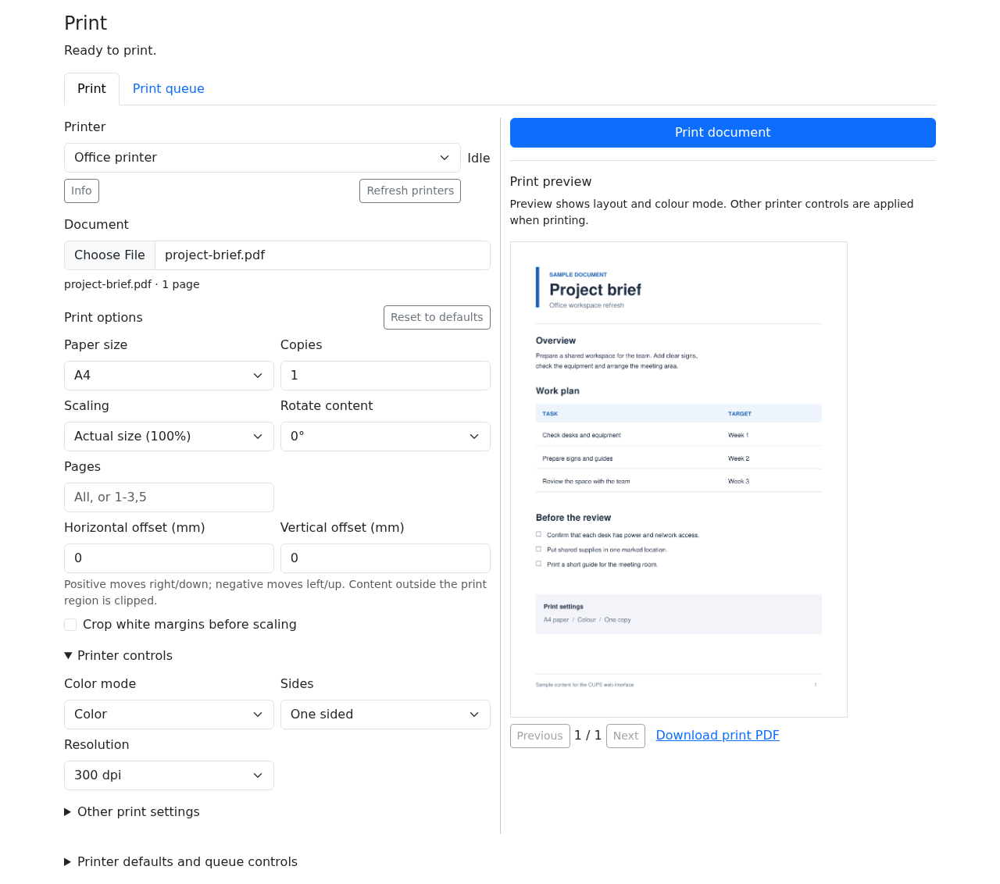

A minimal web interface for CUPS. Upload documents, preview and adjust their
layout, select printer settings, and manage print jobs from a browser. CUPS
supplies printer drivers and queues. Available print features come from each
queue's PPD and IPP capabilities, such as paper sizes, colour, duplex, quality,
trays and finishing.



# Connect to CUPS on Docker host

Configure your printers in CUPS first. Use this method on a Linux Docker host
with a CUPS socket at `/run/cups/cups.sock`.

Pushes to `main` [publish the image](.github/workflows/publish.yaml) to GHCR after checks pass.
The image supports `linux/amd64`. Tags are `latest` and `sha-FULL_COMMIT_SHA`.

The image is private. Use a GitHub account with package access. Enter a
[personal access token (classic)](https://docs.github.com/en/packages/working-with-a-github-packages-registry/working-with-the-container-registry#authenticating-with-a-personal-access-token-classic)
with `read:packages` at the password prompt:

```sh
docker login ghcr.io -u YOUR_GITHUB_USER
```

Start the web interface:

```sh
docker run -d --name cups-web --restart unless-stopped \
  -p 18680:8080 \
  -e CUPS_SERVER=/run/cups/cups.sock \
  --mount type=bind,src=/run/cups,dst=/run/cups,readonly \
  --mount type=volume,src=cups-web-data,dst=/data \
  ghcr.io/sjtrny/label-printer-web:latest
```

CUPS socket permissions must allow access from the container.
Open `http://HOST:18680`. Replace `HOST` with the Docker host's address.
The volume stores uploads, job records, settings and the administrator password.

Printing needs no login. To change printer defaults or manage queues, get the
web administrator password:

```sh
docker exec cups-web cat /data/admin-password
```

# Connect to a networked CUPS server

Configure your printers on the CUPS server. Allow connections from the Docker
host. Log in to GHCR as above, then use this command instead. Replace
`192.168.1.20:631` with the CUPS server's address and port.

```sh
docker run -d --name cups-web --restart unless-stopped \
  -p 18680:8080 \
  -e CUPS_SERVER=192.168.1.20:631 \
  --mount type=volume,src=cups-web-data,dst=/data \
  ghcr.io/sjtrny/label-printer-web:latest
```

Open `http://HOST:18680`. Use the password command above for web administration.
The web password does not grant access to CUPS. Queue administration also needs
permission from the CUPS server.

# Per-printer controls

Controls come from CUPS by default. To change them, create `printers.json`:

```json
{
  "Office": {
    "controls": {
      "Duplex": "primary",
      "Resolution": "advanced",
      "job-priority": "hidden",
      "finishings": "disabled"
    }
  }
}
```

Use the CUPS queue name and option keys. Get queue names from `/api/printers`.
Get option keys from `/api/printers/NAME`.

| Value | Effect |
| --- | --- |
| `primary` | Show beside paper size and copies. |
| `advanced` | Show under **Other print settings**. |
| `hidden` | Hide the control. The API and additional options can still set it. |
| `disabled` | Disable the control. Reject changes through the app. Use the CUPS default. |

Apply the file, then select **Refresh printers**:

```sh
docker cp printers.json cups-web:/data/printers.json
```

Unlisted controls keep their normal position. The file cannot add unsupported
features. A disabled control keeps the CUPS default; it does not turn off the
printer feature.
